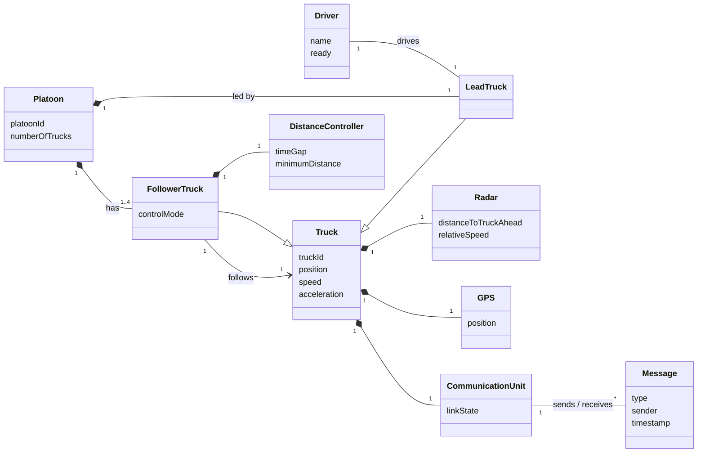
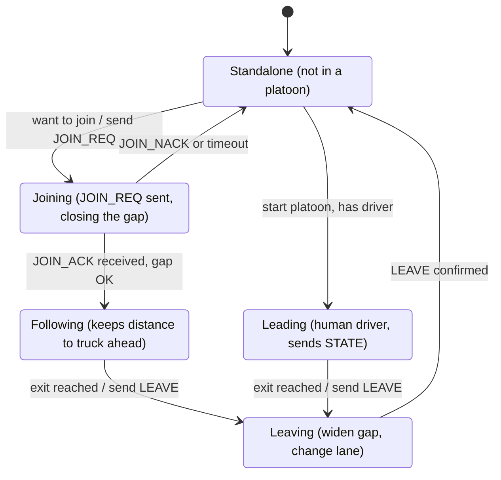
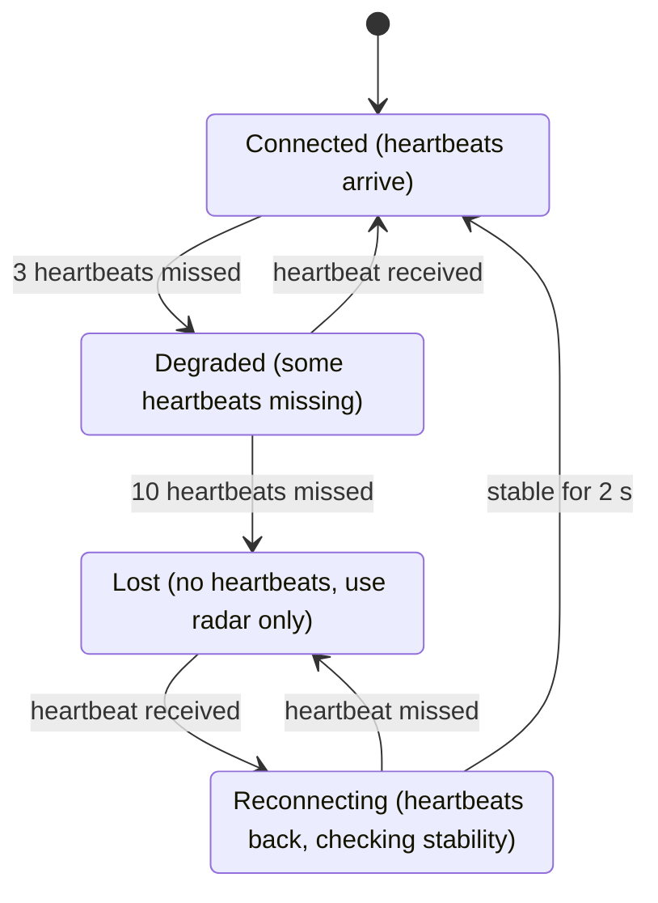
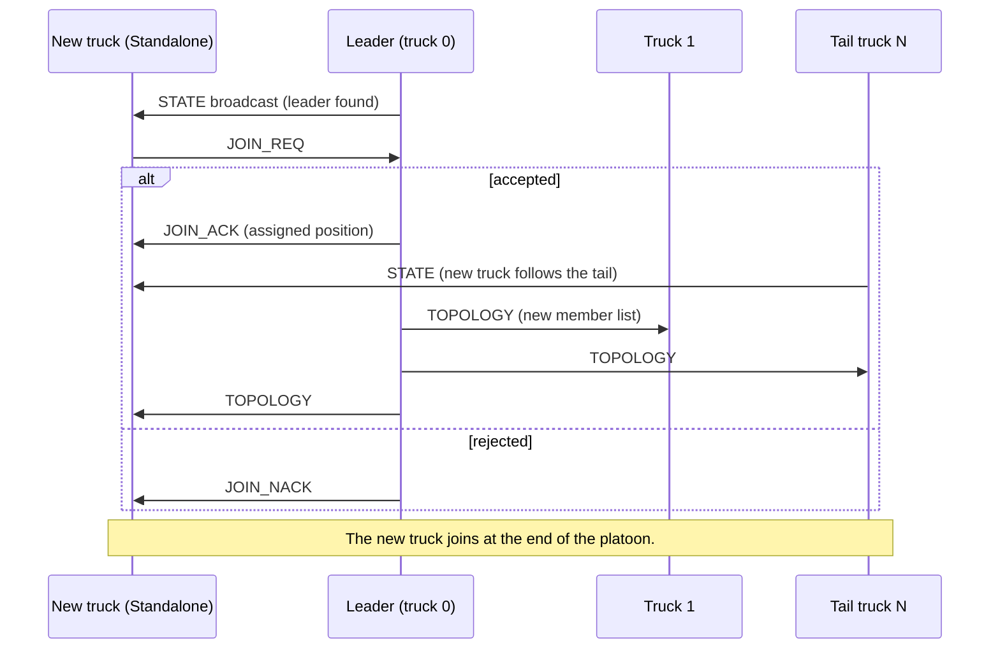
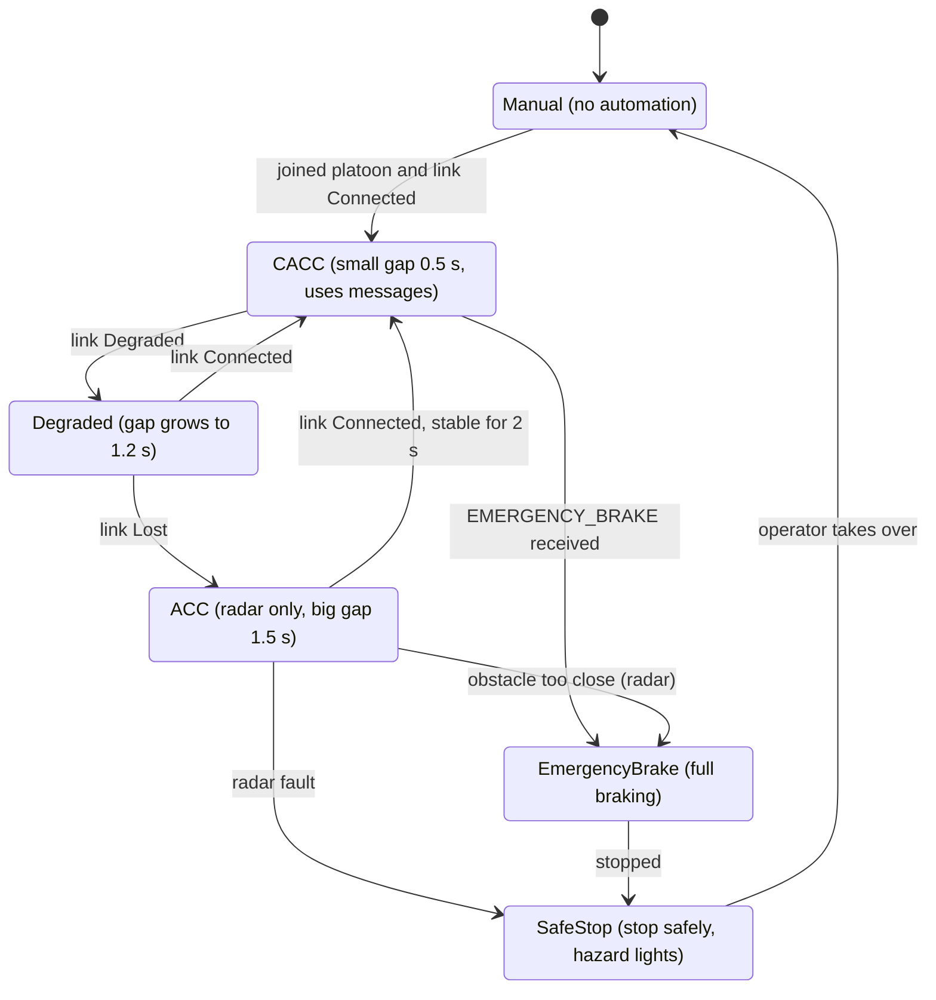
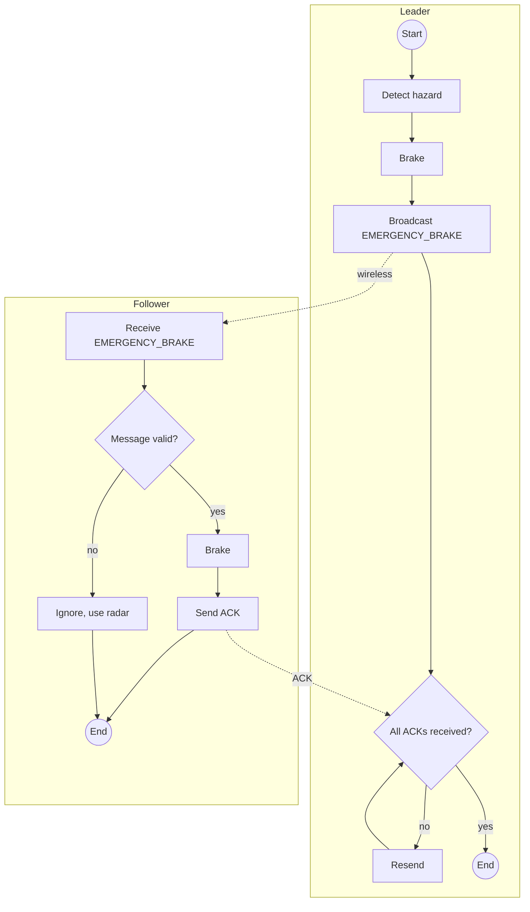

# Truck Platooning — Distributed Systems Semester Project

FH Dortmund, Distributed Systems (Prof. Henkler, Prof. Rettberg).

A platoon is **one lead truck with a human driver followed by several driverless trucks**. The
trucks talk to each other over a wireless link so the followers can drive close behind the truck
ahead. This document covers **Task 1** (communication between the trucks) and **Task 2** (how a
truck keeps a safe distance), plus an initial class diagram of the project.

---

## Overview

| Question from the assignment | Our answer in one line |
|---|---|
| Which data do trucks exchange? | Position, speed and acceleration (many times a second), "I'm alive" signals, and event messages such as join, leave, emergency brake |
| Which protocol? | Regular data is just sent; important events must be confirmed by the receiver, otherwise they are sent again |
| How is the distance guaranteed? | The faster the truck, the bigger the gap; small gap when communication works, big gap when it does not |
| What if communication fails? | The truck notices missing "I'm alive" signals, drives with its own radar and a bigger gap, or stops safely |

## Assumptions

- The project is a **software simulation**: trucks, sensors and the wireless link are simulated.
- A platoon has 1 lead truck (human driver) and 1–8 **driverless** followers (default: 3), as in
  the use case ("one driver, multiple trucks").
- Every truck has a front radar (distance to the truck ahead), GPS, speed sensors, brakes and
  engine control, and a wireless radio to talk to the other trucks.
- The wireless link is **unreliable**: messages can get lost, arrive late, or arrive twice.

---

## Class diagram

Initial class diagram of the project: the main objects in the platooning scenario and how they
are related.



| Class | Meaning |
|---|---|
| `Platoon` | A group of trucks driving together: one lead truck and 1–8 followers |
| `Truck` | A truck in the platoon with its position, speed and acceleration |
| `LeadTruck` | The first truck, driven by a human `Driver` |
| `FollowerTruck` | A driverless truck that follows the truck directly ahead of it |
| `Driver` | The human in the lead truck |
| `Radar` | Measures the distance and relative speed to the truck ahead |
| `GPS` | Gives the truck's position |
| `CommunicationUnit` | Wireless (V2V) link to the other trucks; knows if the link is OK, degraded or lost (Task 1) |
| `Message` | Data exchanged between trucks, e.g. state, heartbeat, join, emergency brake (Task 1) |
| `DistanceController` | Keeps the safe gap to the truck ahead (Task 2) |


---

# Task 1 — Communication Between the Trucks

## 1.1 What the trucks share regularly

These messages are sent all the time, at a fixed rate.

| Information | From → To | How often | Why it is needed |
|---|---|---|---|
| Position, speed, acceleration (`STATE`) | every truck → the others | 20 times per second | the truck behind can keep its distance and react immediately |
| Leader's plan (e.g. "I am about to brake") | leader → all | inside `STATE` | all followers react at the same time, not one after another |
| "I'm alive" signal (`HEARTBEAT`) | every truck → the others | 10 times per second | to notice when the connection to a truck is lost |
| Sensor health (radar, GPS, brakes OK?) | every truck → leader | inside `HEARTBEAT` | the leader knows if a truck has a problem |
| Driver ready | leader → all | inside `HEARTBEAT` | if the driver is not ready, followers slow down and stop safely |

## 1.2 Event messages

These messages are sent only when something happens.

| Message | Sent by | When |
|---|---|---|
| `JOIN_REQ` — join request | new truck → leader | a truck wants to join the platoon |
| `JOIN_ACK` — join accepted | leader → new truck | the leader accepts and tells the truck its position |
| `JOIN_NACK` — join rejected | leader → new truck | platoon is full or joining is not safe |
| `LEAVE` | any truck → leader | a truck leaves (exit, destination reached) |
| `TOPOLOGY` — new member list | leader → all | after any join or leave, so everyone knows the order of trucks |
| `SPLIT_REQ` — open a gap | truck → platoon | a car cuts in between two trucks |
| `MERGE_REQ` — close the gap | truck → platoon | the car has left again |
| `EMERGENCY_BRAKE` | leader or any truck → all | danger ahead, everyone brakes hard |
| `TUNNEL_AHEAD` | leader → all | a tunnel is coming where the wireless link will be lost |
| `ACK` — confirmation | receiver → sender | "I got your message" |

## 1.3 Protocol rules

1. **Regular messages are just sent.** If one gets lost, it does not matter much, because the
   next one comes a moment later.
2. **Event messages must be confirmed.** The receiver answers with an `ACK`. If the sender gets
   no `ACK`, it sends the message again (up to 5 times).
3. **Emergency brake is passed on.** Every follower also forwards the `EMERGENCY_BRAKE` message
   to the trucks behind it, so it reaches the last truck even if the leader's signal is weak.
4. **Every message carries a number and a time.** The number shows when a message is missing or
   arrives twice. The time shows when a message is too old to trust (older than 0.2 s), and it
   is then ignored.
5. **Only platoon members can send valid messages.** Every truck in the platoon gets a secret
   platoon key when it joins. Messages without the right key are ignored, so a fake
   "emergency brake" from outside cannot make the platoon brake.
6. **Simple transport.** In the simulation the trucks send messages over UDP: fast and without a
   fixed connection. Like a real wireless link, messages can get lost, so our rules above
   handle that.

## 1.4 Noticing a lost connection

Each truck counts the "I'm alive" signals it receives from the others:

| Situation | Link state |
|---|---|
| Signals arrive normally | **Connected** |
| 3 signals missed (0.3 s) | **Degraded** (weak) |
| 10 signals missed (1 s) | **Lost** |
| Signals come back | **Reconnecting** |
| Signals stable again for 2 s | back to **Connected** |

The 2-second wait prevents the truck from jumping back and forth between states when the signal
is unstable.

## 1.5 State machines and sequence diagram

**Platoon membership (per truck):** a truck starts alone (*Standalone*). If it has a driver it can
start a platoon as leader (*Leading*). Otherwise it asks to join (*Joining*) and, if accepted,
becomes a follower (*Following*). At its exit it leaves the platoon (*Leaving*).



**Link health:** the states from [1.4](#14-noticing-a-lost-connection).



**Joining the platoon:** the new truck hears the leader, sends a join request, and the leader
either accepts it (and sends the new member list to everyone) or rejects it.



---

# Task 2 — Keeping a Safe Distance

## 2.1 Goal

Every follower must keep a gap to the truck ahead that is **short** (saves fuel, because it drives
in the slipstream) but always **safe**. This must still work when:
- the leader brakes or speeds up
- a car cuts in between two trucks
- the wireless connection fails

## 2.2 How big the gap is

The faster the truck drives, the bigger the gap:

```
gap = minimum distance + time gap × speed
```

| | Connection OK | Connection weak | Radar only (connection lost) |
|---|---|---|---|
| Minimum distance | 5 m | 5 m | 8 m |
| Time gap | 0.5 s | grows from 0.5 s to 1.2 s | 1.5 s |
| Gap at 80 km/h | about 16 m | 16 m → 32 m | about 41 m |

**Why the gap changes:** with a working connection, the follower is told *immediately* when the
truck ahead brakes, so it can brake at the same time and a small gap is safe. Without a
connection it only sees the braking through its radar, which is slower, so it needs a much bigger
gap.

## 2.3 How a follower controls the gap

Many times per second, each follower:
1. **Measures the gap** to the truck ahead with its radar.
2. **Compares** it with the desired gap from [2.2](#22-how-big-the-gap-is).
   - Too close → brake a little.
   - Too far → speed up a little.
3. **Matches the speed** of the truck ahead.
4. **Reacts to the truck ahead immediately:** if the `STATE` message says the truck ahead is
   braking, the follower brakes at the same time instead of waiting until the radar sees the gap
   shrinking. (Only possible when the connection works.)

Braking and acceleration are kept within limits so the ride stays smooth and the cargo is safe.

## 2.4 Driving modes (state machine)



| Mode in diagram | In simple words | When | What the truck does |
|---|---|---|---|
| `Manual` | not automated | not in a platoon | no automation |
| `CACC` | platoon driving with communication | in the platoon, connection OK | small gap (0.5 s), uses messages from the truck ahead |
| `Degraded` | weak connection | some "I'm alive" signals missing | slowly makes the gap bigger (up to 1.2 s) |
| `ACC` | radar only | connection lost | big gap (1.5 s), uses only its own radar |
| `EmergencyBrake` | emergency stop | `EMERGENCY_BRAKE` received, or radar sees an obstacle too close | full braking, forwards the alarm to trucks behind |
| `SafeStop` | stop safely | radar broken while the connection is lost, or brakes/engine fail | slows down gently, stops on the hard shoulder, hazard lights on |

*Tunnel mode* (make the gap bigger **before** entering a tunnel) will be added to the diagram
in a later version.

**Safety rules:**
1. **Bigger gap immediately, smaller gap slowly.** When something goes wrong, the gap grows at
   once. When things are OK again, the gap shrinks only slowly.
2. **No jumping between modes.** Going back from radar-only to platoon driving needs 2 s of
   stable connection.
3. **The radar always watches.** In every mode, if the radar sees the truck ahead getting
   dangerously close, the truck brakes, no matter what the messages say.
4. **When in doubt, be careful.** If something does not make sense (for example the messages and
   the radar disagree), the truck switches to radar-only mode.

## 2.5 Emergency brake (activity diagram)

The leader detects danger, brakes, and sends `EMERGENCY_BRAKE` to all followers. Each follower
checks that the message is genuine, brakes, and sends back an `ACK`. The leader keeps resending
until every follower has confirmed.



## 2.6 What can go wrong

| # | Problem | How the truck notices | What it does | Still safe? |
|---|---|---|---|---|
| F1 | A single message is lost | message number is missing | uses the last known values for a moment | yes |
| F2 | Connection weak | 3 "I'm alive" signals missed | `Degraded`: gap slowly grows | yes |
| F3 | Connection lost | 10 signals missed | `ACC`: radar only, big gap | yes |
| F4 | Tunnel ahead | `TUNNEL_AHEAD` message | makes the gap bigger **before** the tunnel | yes |
| F5 | Radar broken, connection OK | sensor health message | keeps driving using the messages, leaves the platoon at the next exit | yes |
| F6 | Radar broken **and** connection lost | both | `SafeStop` | yes |
| F7 | Leader truck fails or driver not ready | leader's signals stop | followers switch to radar only, then `SafeStop` (driverless trucks cannot lead) | yes |
| F8 | A car cuts in | radar suddenly sees something closer | opens a gap behind the car (`SPLIT_REQ`), closes it again when the car has left (`MERGE_REQ`) | yes |
| F9 | Fake emergency brake message | wrong platoon key | message ignored | yes |

**Leader failure (F7) in more detail:** only the lead truck has a driver, so no follower can
take over the lead. The followers first keep following each other using their radar. If the
leader does not come back, they all stop safely.
*Possible later extension:* if other trucks also had drivers, the platoon could choose a new
leader instead of stopping.

---

## Our idea: Platoon Guardian

A platoon that protects itself, without a central server:

1. **Never trust old information.** Each truck checks whether messages are missing, late, or
   duplicated, and does not use old data to decide how close to drive.
2. **Everyone brakes together.** The emergency brake message is confirmed, resent and passed on,
   so all trucks brake at the same time. Fake alarms are ignored.
3. **The platoon repairs itself.**
   - A truck leaves or fails → the leader sends a new member list and the truck behind closes the gap.
   - A car cuts in → the platoon opens a gap and closes it again later.
   - Connection comes back → the truck returns to platoon driving only after 2 s of stable signal.
   - Leader fails → followers drive by radar, then stop safely.

## Test scenarios

We will test these situations in the simulation (for example by deliberately dropping messages):

| # | Situation | Expected result |
|---|---|---|
| T1 | Everything normal | connection OK, followers drive with a small gap |
| T2 | A message arrives too late | it is ignored, nothing changes |
| T3 | A message arrives twice | the copy is ignored |
| T4 | 3 "I'm alive" signals missed | connection weak, gap grows |
| T5 | 10 signals missed | connection lost, radar only |
| T6 | Connection comes back | back to normal only after 2 s of stable signal |
| T7 | Emergency brake while many messages get lost | still reaches all trucks (resending + passing on) |
| T8 | Fake emergency brake | ignored, no braking |
| T9 | A truck joins at the end | join request → accepted → new member list sent to all |
| T10 | Two trucks want to join at the same time | both get a different position |
| T11 | A truck leaves | new member list, gap closes |
| T12 | A car cuts in | gap opens, closes again when the car has left |
| T13 | Tunnel ahead | gaps grow before the connection is lost |
| T14 | Leader's signal lost | followers drive by radar, then stop safely |

---

## Repository structure and milestones

```
README.md          this document (Task 1 + Task 2 + class diagram)
docs/diagrams/     original diagram files (.drawio) and pictures (.png);
                   the README draws the same diagrams directly (Mermaid)
```

| Milestone | Content | Status |
|---|---|---|
| 1 | First version of Tasks 1 and 2, team building | in progress |
| 2 | Task 3: program the platoon with pthreads / OpenMP | open |
